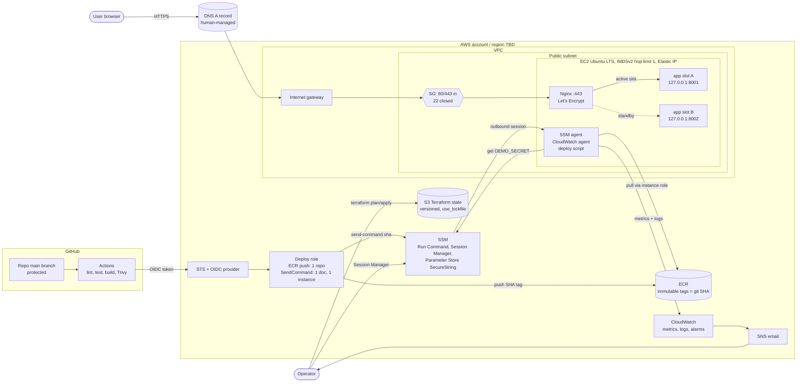

# aws-deploy-pipeline

An end-to-end AWS deployment pipeline for a small Python service, built to be deployed, broken on purpose, diagnosed and recovered. Terraform builds the network, host, IAM and state. Ansible configures the host. Docker runs the app. GitHub Actions builds and deploys it through OIDC and SSM, with automatic rollback. CloudWatch watches it. The app ([`app/`](app/)) is intentionally minimal (`/health`, `/version` and an index page), so the work is in the infrastructure around it.

**Status, 2026-10-28: nothing is deployed to AWS yet.** What exists today: the app and its tests, the design docs and ADRs, and local guardrail tests written *before* the Terraform they check. Everything below separates what has been run from what is planned.

## Architecture

Target design (not deployed). The source is [`docs/architecture/diagrams/architecture.mmd`](docs/architecture/diagrams/architecture.mmd); full detail is in [`architecture.md`](docs/architecture/architecture.md).



### Request path

Browser → DNS A record → Elastic IP → security group (443) → ufw → Nginx (TLS termination) → `127.0.0.1:8001` or `:8002`, whichever slot is active → app container `:8000`. The app is reachable only on loopback. Port 80 serves only the Let's Encrypt challenge and a redirect to HTTPS.

### Deploy path and automatic rollback

1. A push to `main` runs lint, tests, the image build and a Trivy scan.
2. The workflow assumes the deploy role through GitHub OIDC. The trust policy is pinned to this repo's `main` branch, and no AWS keys are stored anywhere.
3. It pushes the image to ECR, tagged with the full git SHA (tags are immutable).
4. It calls `ssm:SendCommand` with a custom deploy document whose only parameter is a 40-hex SHA. CI cannot run arbitrary commands on the host ([ADR 0002](docs/architecture/adr/0002-deploy-via-ssm-run-command.md)).
5. On the host, the deploy script pulls the image, reads the app secret from Parameter Store, starts the new release in the **inactive** slot, and polls its `/health`.
6. **Healthy:** it switches the Nginx upstream, reloads Nginx, stops the old slot and records `current`/`previous` SHAs on the host.
   **Not healthy:** it removes the new container and exits non-zero, so the pipeline goes red. The old slot never stopped serving. If a failure happens after the switch, the previous upstream is restored first.

The broken release never receives traffic. A bug that passes `/health` but breaks pages is **not** caught: that needs a manual rollback from the host using the recorded `previous` SHA, which works without CI. Details: [deployment.md](docs/architecture/deployment.md).

## What's proven so far

Only items with evidence in this repo. Labels: **tested and passed** / **implemented, not tested** / **blocked**.

| Claim | Evidence | Status |
|---|---|---|
| The app's 14 tests pass and lint is clean | [`tests/test_app.py`](tests/test_app.py); `pytest` → 14 passed, `ruff check .` → all checks passed (2026-10-28) | Tested and passed |
| The Terraform guardrail tests catch what they claim to: required tags, no SSH by default, /32-only SSH, IMDSv2 with hop limit 1, encrypted EBS, OIDC trust pinned to this repo's `main` | [`guardrails.tftest.hcl`](infra/terraform/envs/dev/tests/guardrails.tftest.hcl) against a minimal [fixture](infra/tests/terraform_mutation/fixture/main.tf): 6/6 runs pass. [`mutate.py`](infra/tests/terraform_mutation/mutate.py) breaks one rule at a time, and each of the **18 mutations** fails exactly the run named for it (2026-10-24, [record](docs/architecture/deployment.md#64-harness-verification-record)) | Tested and passed |
| The custom checkov policy `CKV_ADP_1` (required tags on every AWS provider) works | [`required_default_tags.py`](infra/terraform/checkov/required_default_tags.py): passes on the fixture, and catches 4 tag mutations (same `mutate.py` run) | Tested and passed |
| checkov passes on the real Terraform | There is no real Terraform yet (`infra/terraform/envs/dev` holds only its tests), so checkov currently scans nothing. Its exit 0 proves nothing | Blocked until Day 4 |
| CI runs these checks on every PR | [`ci.yml`](.github/workflows/ci.yml) is written but has **never run on GitHub** | Implemented, not tested |

The guardrail tests are the spec the real Terraform must meet; they are not evidence about AWS. Nothing about Ansible, Docker, deploy/rollback or AWS is proven yet. The Ansible and rollback test scripts exist in [`infra/ansible/tests/`](infra/ansible/tests/), but there is nothing for them to run against until Days 2–3.

## Roadmap

| Day | Deliverable | Status | Done when |
|---|---|---|---|
| 1 | Demo app + tests, architecture docs, ADRs 0001–0005, local test harness, `ci.yml` | In progress | `ci.yml` passes on GitHub |
| 2 | Ansible roles (base, ssh, firewall, docker, nginx with self-signed TLS) on a local OrbStack Ubuntu 24.04 machine | Planned | `idempotence.sh --fresh` and each `--role` report `changed=0` on the second run |
| 3 | Dockerfile, on-host deploy script (two slots, health gate, automatic rollback), watchdog, all local | Planned | `deploy_rollback.sh` passes; Trivy findings written up |
| 4 | Terraform on AWS: bootstrap (state bucket, budget), then dev env (VPC, SG, EC2, IAM, ECR, OIDC) | Planned | `terraform test` and checkov pass on the real config, the `tags_all` check prints nothing, the instance shows Online in SSM |
| 5 | Ansible on AWS with Let's Encrypt TLS, `deploy.yml` via OIDC → ECR → SSM | Planned | One green deploy, plus one deliberately broken deploy that rolls back automatically (run links saved) |
| 6 | CloudWatch alarms → SNS email, 2 incident drills (hung app, 443 blocked), Makefile `up`/`destroy` | Planned | Alarm emails actually arrive; two write-ups in `docs/incidents/` |
| 7 | Demo docs | Planned | Someone can clone the repo and follow it |

### Later

- Disk-full drill
- Expired-certificate drill (simulated with a short-lived self-signed cert, not a real Let's Encrypt one)
- Certificate-expiry alarm (< 14 days)
- Claude Code skills for the repeatable workflows (infra change, deploy and rollback, incident drill)
- Auto Scaling group of one, so a failed instance replaces itself

## Key decisions

- [ADR 0001](docs/architecture/adr/0001-single-ec2-public-subnet.md): one EC2 instance in a public subnet, with no ALB, no NAT Gateway and no private subnets; zero-downtime deploys use two slots on the host.
- [ADR 0002](docs/architecture/adr/0002-deploy-via-ssm-run-command.md): deploy through SSM Run Command with a custom document that accepts only a SHA; no SSH from CI, and CI is not a root shell.
- [ADR 0003](docs/architecture/adr/0003-ecr-image-registry.md): ECR with immutable SHA tags, so the instance pulls with its role and needs no registry credential.
- [ADR 0004](docs/architecture/adr/0004-terraform-s3-backend-native-locking.md): S3 backend with native lockfile locking and no DynamoDB, which requires Terraform ≥ 1.11.
- [ADR 0005](docs/architecture/adr/0005-secrets-in-ssm-parameter-store.md): the app secret is a SecureString in Parameter Store, created by a human and never managed by Terraform, so it never reaches state.

## Security approach

Full threat model and IAM design: [security.md](docs/architecture/security.md).

| Implemented (in this repo now) | Planned (with the day it lands) |
|---|---|
| Claude Code deny rules block `terraform apply/destroy`, AWS deletes, IAM and DNS changes, and force-push ([`.claude/settings.json`](.claude/settings.json)) | OIDC deploy role: ECR push to one repo, `SendCommand` on one document and one instance (Day 4) |
| `.env`, state, `*.tfvars` and `*.pem` are gitignored; only [`.env.example`](.env.example) with placeholders is committed | Instance role limited to SSM, ECR pull for this repo, CloudWatch, and reading `/<project>/<env>/*` (Day 4) |
| App fails closed: it refuses to start without its secret outside `dev`, the secret is excluded from reprs, and request logs carry no query strings, headers or bodies ([`app/config.py`](app/config.py), [`app/main.py`](app/main.py)) | Security group 80/443 only, port 22 closed, ufw mirroring it, shell access through Session Manager (Days 2 and 4) |
| Runtime and dev dependencies pinned to exact versions (not hashes) | Secret in Parameter Store, read at container start, never written to disk (Days 3 and 5) |
| CI actions pinned to commit SHAs, `contents: read` only, no AWS credentials in PR checks ([`ci.yml`](.github/workflows/ci.yml); not yet run) | Non-root container with a pinned base image; Trivy fails the build on CRITICAL (Days 3 and 5) |
| Guardrail tests that the Terraform must pass: SSH closed by default, IMDSv2 with hop limit 1 (containers cannot reach instance credentials), encrypted EBS, `StringEquals` trust on `repo:mohammed-shanid/aws-deploy-pipeline:ref:refs/heads/main` | Branch protection on `main` (human action, before Day 5); AWS Budget alert (Day 4); cert-expiry alarm (Later) |

## Cost

**Estimate: about $20.50/month in `us-east-1`, about $21.90/month in `ap-south-1`.** These are on-demand list prices for a 730-hour month, with Free Tier not subtracted, checked on 2026-10-24. The region is not decided yet. Most of the cost is the `t3.small` instance (~$15) and its public IPv4 address (~$3.65). Nothing has run on AWS, so nothing is measured. Breakdown, sources and the rejected options (NAT Gateway, ALB, Synthetics): [cost-estimate.md](docs/architecture/cost-estimate.md).

## Run it locally

Everything here was run on macOS. It needs Python 3.12.14 ([`.python-version`](.python-version)); Terraform 1.16.7 is pinned in [`mise.toml`](mise.toml).

App, tests and lint:

```bash
python3.12 -m venv .venv
.venv/bin/pip install -r requirements-dev.txt
.venv/bin/pytest                          # 14 passed
.venv/bin/ruff check .

APP_ENV=dev .venv/bin/python -m app       # serves on 127.0.0.1:8000; Ctrl+C stops it
curl http://127.0.0.1:8000/health         # {"status":"ok"}
curl http://127.0.0.1:8000/version
```

`APP_ENV=dev` makes the app secret optional. Without it, the app treats the environment as `prod` and exits with code 2 unless `DEMO_SECRET` is set.

Terraform guardrail mutation check (about 3 minutes; downloads the AWS provider on first run):

```bash
mise install
python3.12 -m venv .venv-infra
.venv-infra/bin/pip install -r requirements-infra.txt
.venv/bin/python infra/tests/terraform_mutation/mutate.py   # ALL 22 MUTATIONS CAUGHT AS EXPECTED
```

## Out of scope, and why

| Not here | Why | What would change that |
|---|---|---|
| Kubernetes / EKS | One stateless container on one host. A cluster would add a control plane, node management and its own failure modes, and hide the host-level work this repo exists to practise (Ansible, Nginx, certificates, disk) | Several services that need scheduling, or a team already running Kubernetes |
| Multi-cloud | No requirement for it. The design depends on AWS-native identity (OIDC to IAM, instance roles, SSM), and abstracting that away would cost more than it teaches | A real customer or regulatory requirement for a second provider |
| ALB and NAT Gateway | Each would cost about as much as the instance or more (estimates in [cost-estimate.md](docs/architecture/cost-estimate.md)). An ALB buys nothing with one instance, and a NAT Gateway buys nothing with no private subnets ([ADR 0001](docs/architecture/adr/0001-single-ec2-public-subnet.md)) | ALB: an uptime target, or a second instance. NAT (or VPC endpoints): a component such as a database that must not be internet-reachable |

How this repo is worked on: [`CLAUDE.md`](CLAUDE.md) (rules for Claude Code sessions) and [`PROMPTS.md`](PROMPTS.md) (the phase-by-phase plan).
